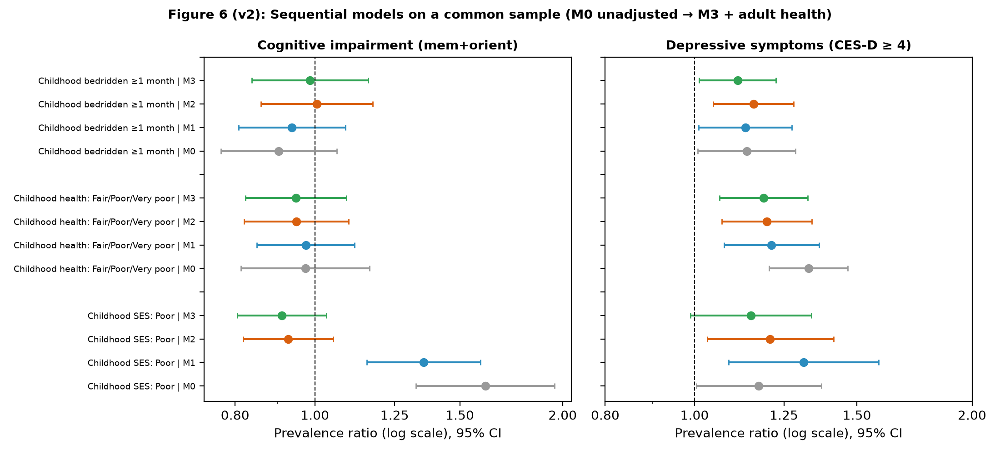

# Early-Life Disadvantage and Later-Life Mental and Cognitive Health in India

[](https://www.python.org/downloads/)
[](https://www.iipsindia.ac.in/lasi/)
[-orange.svg)](protocol.md)

An end-to-end, design-based epidemiological investigation examining the enduring and pathway associations of childhood socioeconomic and somatic disadvantage on later-life depressive symptoms and cognitive impairment among older adults ($\ge 45$ years) in the **Longitudinal Ageing Study in India (LASI) Wave 1 (2017–2018)** ($N = 66,606$).

---

## Table of Contents
1. [Overview and Key Empirical Findings](#overview-and-key-empirical-findings)
2. [Prerequisites and System Requirements](#prerequisites-and-system-requirements)
3. [Installation and Environment Setup](#installation-and-environment-setup)
4. [Dataset Setup](#dataset-setup)
5. [Instructions to Run the Application](#instructions-to-run-the-application)
   - [Option A: One-Command Master Execution](#option-a-one-command-master-execution-recommended)
   - [Option B: Step-by-Step Script Execution](#option-b-step-by-step-script-execution)
   - [Option C: Compiling the LaTeX Report to PDF](#option-c-compiling-the-latex-report-to-pdf)
6. [Repository Structure](#repository-structure)
7. [Statistical Methodology and Guardrails](#statistical-methodology-and-guardrails)
8. [Data Access and Acknowledgments](#data-access-and-acknowledgments)

---

## Overview and Key Empirical Findings

Using survey-weighted modified Poisson regression with stratified cluster-robust variance estimation (72 strata, 2,428 sampling clusters, $df = 2,356$), this study evaluates life-course epidemiological paradigms (**biological scarring** vs. **accumulation of disadvantage**) in an upper-middle and low-to-middle income country setting.



### Summary of Key Results
| Outcome Metric | Analytic Sample | Childhood Exposure | Model 1: Demographics (PR, 95% CI) | Model 2: + Adult SES (APR, 95% CI) | Substantive Verdict |
| :--- | :---: | :--- | :---: | :---: | :--- |
| **Depressive Symptoms**<br>(CES-D-10 $\ge 4$) | $N = 62,047$ | **Poor Childhood Health** | **1.21** (1.08–1.36) | **1.20** (1.07–1.34) | **Persistent Somatic Scarring** ($p=0.002$) |
| | | **Poor Childhood SES** | **1.31** (1.09–1.58) | **1.21** (1.03–1.42) | **Persistent Disadvantage** ($p=0.019$) |
| | | **Bedridden $\ge 1$ Month** | **1.14** (1.01–1.27) | **1.16** (1.05–1.28) | **Persistent Illness Scarring** ($p=0.005$) |
| | | **Cumulative Disadvantage** | — | **1.11** (1.07–1.16) | **Linear Dose-Response** ($+11.4\%$/adversity) |
| **Cognitive Impairment**<br>(Lowest Decile, Memory+Orientation) | $N = 57,245$ | **Poor Childhood SES** | **1.36** (1.16–1.59) | **0.93** (0.82–1.05) | **Full Attenuation by Schooling** ($p=0.241$) |
| | | **Poor Childhood Health** | 0.97 (0.85–1.12) | 0.95 (0.82–1.10) | **No Association** ($p=0.487$) |
| | | **Bedridden $\ge 1$ Month** | 0.94 (0.81–1.09) | 1.00 (0.86–1.18) | **No Association** ($p=0.947$) |

* **Mental Health Divergence:** Childhood physical illness and severe poverty leave an enduring imprint on late-life depression that is **not attenuated** by adult education, adult wealth, or adult chronic disease.
* **Cognitive Plasticity:** Early-life socioeconomic disparities in episodic memory and orientation are **fully attenuated** once adult schooling is accounted for, indicating that access to education acts as a protective buffer ("cognitive reserve").

---

## Prerequisites and System Requirements

- **Operating System:** Linux, macOS, or Windows (WSL recommended)
- **Python:** Python 3.10, 3.11, or 3.12
- **LaTeX (Optional, for building PDF locally):** `pdflatex` (e.g., `texlive-scheme-medium` on Fedora/RHEL or `texlive-latex-recommended` on Ubuntu/Debian)

---

## Installation and Environment Setup

### 1. Clone the Repository
```bash
git clone https://github.com/Harsheeee/SOC450.git
cd SOC450
```

### 2. Create and Activate a Virtual Environment
```bash
# On Linux / macOS:
python3 -m venv .venv
source .venv/bin/activate

# On Windows (Command Prompt / PowerShell):
python -m venv .venv
.venv\Scripts\activate
```

### 3. Install Dependencies
```bash
pip install --upgrade pip
pip install -r requirements.txt
```

---

## Dataset Setup

The replication pipeline analyzes microdata from the **Longitudinal Ageing Study in India (LASI) Wave 1 (2017–2018)**.

### Option 1: Using the Included Clean Cohort (Fastest)
The repository includes the cleaned analytical parquet file:
- `data_analysis/lasi_clean_v2.parquet` ($N = 66,606$, compressed ~2.4 MB)

This allows you to **immediately reproduce all models, sensitivity analyses, tables, and figures** without having to download the 1.4 GB raw Stata microdata.

### Option 2: Building from Raw Microdata
If you wish to re-run the extraction from the original raw survey files:
1. Request access to LASI Wave 1 microdata from the [International Institute for Population Sciences (IIPS)](https://www.iipsindia.ac.in/lasi/) or [Gateway to Global Aging Data](https://g2aging.org/).
2. Place the unzipped Stata file `3_LASI_W1_Individual_v4.dta` into the `dataset/` directory:
   ```
   dataset/3_LASI_W1_Individual_v4.dta
   ```
3. Run `python code/07_build_dataset_v2.py` to regenerate the analytic dataset.

---

## Instructions to Run the Application

### Option A: One-Command Master Execution (Recommended)

Run the master script to execute the entire end-to-end pipeline automatically:
```bash
bash run_replication.sh
```

This single command will:
1. Check the data source (building from raw data or using the clean parquet cohort).
2. Fit all sequential survey-weighted models (M0 through M3) for depression and cognition.
3. Compute joint interaction Wald $F$ tests, standardized risk predictions, and IPW sensitivity models.
4. Generate publication-quality forest plots (`outputs/figures_v2/figure6v2_forest_sequential.png`).
5. Build all diagnostic tables, summaries, and Markdown reports.
6. Assemble the master LaTeX research manuscript at `report/final_research_report.tex`.

---

### Option B: Step-by-Step Script Execution

If you prefer to execute each analytical phase independently:

#### 1. Extract and Build Analytic Cohort (Optional if using included parquet)
```bash
python code/07_build_dataset_v2.py
```
* **Input:** `dataset/3_LASI_W1_Individual_v4.dta`
* **Output:** `data_analysis/lasi_clean_v2.parquet` (66,606 respondents aged 45+)

#### 2. Fit Survey-Weighted Regression Models and Sensitivity Analyses
```bash
python code/08_models_v2.py
```
* **Tasks performed:**
  - Sequential Modified Poisson models (M0, M1, M2, M3) on common complete-case samples ($N = 57,245$ cognition; $N = 62,047$ depression).
  - Continuous linear models for memory/orientation scores (0–28) and CES-D-10 (0–10).
  - Mutually adjusted exposure models and cumulative adversity index.
  - Joint Wald $F$ interaction tests across age groups ($45\text{--}59$, $60\text{--}74$, $75+$).
  - Inverse-Probability Weighting (IPW) for direct cognitive test non-response.
  - Measurement sensitivity: Comparison of memory+orientation vs. full cognitive battery.
* **Outputs:** CSV tables in `outputs/tables_v2/`

#### 3. Generate Sequential Model Forest Plots
```bash
python code/09_forest_plot_v2.py
```
* **Output:** `outputs/figures_v2/figure6v2_forest_sequential.png` (and synced to `report/figures/`)

#### 4. Compile Markdown Research Report
```bash
python code/10_generate_report_v2.py
```
* **Output:** `report/final_research_report_v2.md`

#### 5. Generate Journal-Grade LaTeX Document
```bash
python code/11_generate_latex_report.py
```
* **Output:** `report/final_research_report.tex` (incorporating technical glossary, width-constrained tables, and cross-references)

---

### Option C: Compiling the LaTeX Report to PDF

To compile the master LaTeX manuscript to a PDF locally:

```bash
bash code/compile_latex.sh
```
*(Requires `pdflatex`. If not installed on Fedora/RHEL run `sudo dnf install texlive-scheme-medium`, or on Ubuntu/Debian run `sudo apt install texlive-latex-recommended texlive-latex-extra`.)*

Alternatively, you can open and compile [`report/final_research_report.tex`](report/final_research_report.tex) in your preferred LaTeX editor (such as TeXworks, VS Code LaTeX Workshop, or Overleaf).

The pre-compiled 18-page vector PDF is also directly accessible at:
- [`report/final_research_report_v2.pdf`](report/final_research_report_v2.pdf)

---

## Repository Structure

```
├── README.md                               <-- Master replication guide and documentation
├── protocol.md                             <-- Analysis protocol and Protocol Amendment 1
├── checkpoints.md                          <-- Comprehensive milestone and audit trail log
├── requirements.txt                        <-- Pinned Python package dependencies
├── run_replication.sh                      <-- Master execution script for the entire pipeline
├── variable_map.csv                        <-- Variable codebook and mapping dictionary
│
├── dataset/
│   └── README.md                           <-- Instructions for acquiring LASI microdata
│
├── data_analysis/
│   └── lasi_clean_v2.parquet               <-- Cleaned analytic cohort dataset (N = 66,606)
│
├── code/
│   ├── 01_build_variable_map.py            <-- Harmonization map builder
│   ├── 02_extract_and_clean.py             <-- (v1) Initial extraction script
│   ├── 03_descriptive_analysis.py          <-- Weighted descriptive statistics
│   ├── 04_regression_models.py             <-- (v1) Initial regression scripts
│   ├── 05_sensitivity_analyses.py          <-- (v1) Initial sensitivity checks
│   ├── 06_generate_html_report.py          <-- (v1) Initial report script
│   ├── 07_build_dataset_v2.py              <-- Corrected analytic dataset builder
│   ├── 08_models_v2.py                     <-- Design-based Poisson models M0–M3 & IPW
│   ├── 09_forest_plot_v2.py                <-- Sequential forest plot generator
│   ├── 10_generate_report_v2.py            <-- Markdown report generator
│   ├── 11_generate_latex_report.py         <-- Journal-grade LaTeX report generator
│   ├── survey_utils.py                     <-- Stratified cluster Taylor linearization
│   └── compile_latex.sh                    <-- Shell script to compile LaTeX to PDF
│
├── outputs/
│   ├── diagnostics/                        <-- Sample flow, missingness summaries, logs
│   ├── tables_v2/                          <-- Formatted regression tables & tests (CSV)
│   └── figures_v2/                         <-- Publication vector-quality charts (PNG)
│
└── report/
    ├── final_research_report.tex           <-- Master LaTeX manuscript
    ├── final_research_report_v2.pdf        <-- 18-page standalone publication PDF
    ├── final_research_report_v2.md         <-- Complete academic manuscript in Markdown
    └── figures/                            <-- Report graphics and interaction charts
```

---

## Statistical Methodology and Guardrails

1. **Design-Based Survey Linearization:** Standard errors are calculated using stratified cluster Taylor series linearization across 72 strata (State $\times$ Rural/Urban) and 2,428 clusters (`ssuid`), utilizing $t$-distribution critical values with $df = 2,356$.
2. **Modified Poisson vs. Logistic Odds Ratios:** Log-binomial / modified Poisson models with sandwich robust estimators are employed to avoid Odds Ratio inflation for common outcomes (depression prevalence = 28.2%).
3. **Common Complete-Case Samples:** Sequential models (M0 through M3) are evaluated strictly on fixed, common analytic cohorts ($N = 57,245$ for cognition; $N = 62,047$ for depression) to ensure comparability of coefficient attenuation.
4. **Inverse-Probability Weighting (IPW):** Evaluated selection bias resulting from cognitive non-response ($7.8\%$ missing direct tests among direct interviewees). IPW-adjusted estimates matched complete-case models ($\text{APR} = 0.928$ vs. $0.928$), confirming robustness under Missing at Random (MAR).
5. **Non-Causal Associational Guardrails:** Cross-sectional single-wave observations are strictly interpreted as population-level prevalence associations, explicitly rejecting causal mediation claims.

---

## Data Access and Acknowledgments

Data collected by the **International Institute for Population Sciences (IIPS)**, Mumbai, in collaboration with the **Harvard T.H. Chan School of Public Health** and the **University of Southern California (USC)**, funded by the **Ministry of Health and Family Welfare (MoHFW)**, Government of India, and the **National Institute on Aging (NIA/NIH)**.

For data access policies and codebooks, visit:
- IIPS LASI Portal: [https://www.iipsindia.ac.in/lasi/](https://www.iipsindia.ac.in/lasi/)
- Gateway to Global Aging Data: [https://g2aging.org/](https://g2aging.org/)
